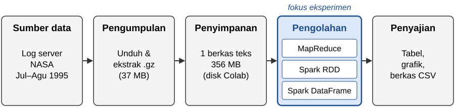
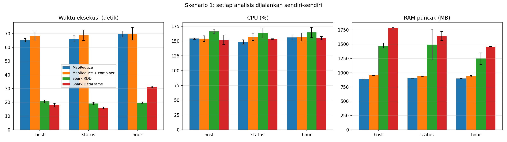
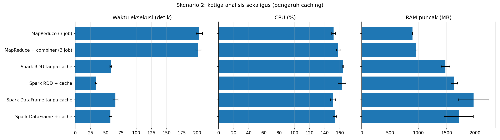
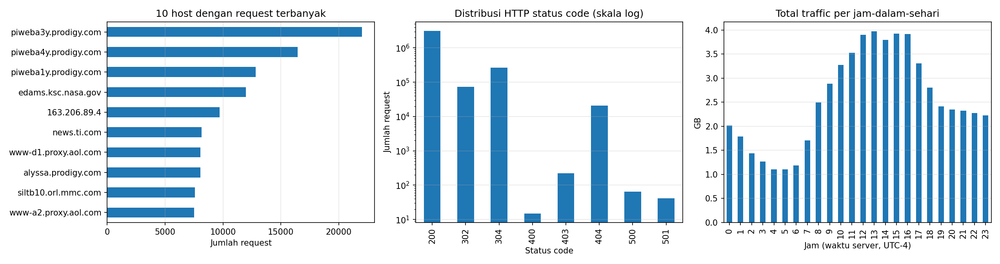
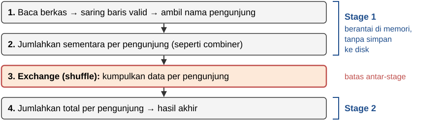

# Laporan Tugas 2
## Implementasi Pipeline Pemrosesan Batch dengan Hadoop MapReduce dan Apache Spark


**Mata Kuliah:** Pemrosesan Data Terdistribusi / Big Data Analytics
**Dosen Pengampu:** Hanafi, S.Kom., M.Eng., Ph.D.
**Kelompok 21**

| No | Nama | NIM |
|---|---|---|
| 1 | Eka Putra Kurnia | 25.55.2927 |
| 2 | Zahrul Amri Hutabarat | 25.55.2900 |
| 3 | Bujur Depoin Sianipar | 25.55.2879 |
| 4 | Riyan Pratomo Saputra | 25.55.2857 |

**Universitas AMIKOM Yogyakarta**
**Oktober 2026**

---

## Bab 1. Pendahuluan

### 1.1 Tujuan Eksperimen

Hadoop MapReduce dan Apache Spark sama-sama dipakai untuk mengolah data dalam jumlah besar
sekaligus (*batch processing*). Perbedaan utamanya: MapReduce menyimpan hasil setiap tahap ke
**disk**, sedangkan Spark sebisa mungkin menyimpannya di **memori (RAM)**.

Dalam eksperimen ini kami mengolah data yang sama dengan tiga cara: **MapReduce** (memakai
library mrjob), **Spark RDD**, dan **Spark DataFrame**. Tujuannya:

1. membuktikan ketiga cara memberi jawaban yang sama;
2. mengukur waktu, pemakaian CPU, dan pemakaian RAM masing-masing;
3. menjelaskan mengapa hasilnya berbeda.

### 1.2 Arsitektur Data

Sistem Big Data biasanya terdiri dari beberapa lapisan: sumber data, pengumpulan, penyimpanan,
pengolahan, dan penyajian. Eksperimen ini berfokus pada **lapisan pengolahan** (*processing*).



*Gambar 1.1 — Alur data dalam eksperimen. Kotak biru adalah lapisan yang dibandingkan.*

Semua proses berjalan di **satu komputer** (Google Colab dengan 2 inti CPU), bukan di banyak
komputer. Pekerjaan memang dibagi ke beberapa "pekerja", tetapi semua pekerja itu berada di mesin
yang sama. Jadi eksperimen ini adalah **simulasi** pengolahan terdistribusi.

### 1.3 Dataset

Kami memakai **NASA HTTP Access Logs**, yaitu catatan setiap kunjungan ke situs web NASA selama
Juli–Agustus 1995. Ukurannya **356 MB** dengan **3.461.613 baris**. Satu baris berisi satu
kunjungan (*request*):

```
199.72.81.55 - - [01/Jul/1995:00:00:01 -0400] "GET /history/apollo/ HTTP/1.0" 200 6245
   pengunjung            waktu                      halaman yang diminta     status ukuran
```

Sebelum diolah, data dibersihkan:

- 18 baris mengandung karakter aneh. Karakter itu diganti dengan `?` agar ketiga cara membaca
  teks yang sama persis.
- Hanya **1 baris** yang rusak (terpotong) sehingga dibuang. Tersisa **3.461.612 request** yang
  valid.

### 1.4 Cara Eksperimen

**Tiga pertanyaan** yang dijawab dari data:

| Kode | Pertanyaan | Jumlah kelompok jawaban |
|---|---|---|
| `host` | Siapa yang paling sering mengakses? (jumlah request per pengunjung) | 137.978 pengunjung |
| `status` | Berapa request yang berhasil dan yang gagal? (jumlah per kode status) | 8 kode |
| `hour` | Jam berapa server paling sibuk? (total data yang dikirim per jam) | 24 jam |

**Empat cara pengolahan:** MapReduce, MapReduce dengan *combiner* (penjelasan di 3.2), Spark RDD,
dan Spark DataFrame.

**Dua skenario:**
1. Setiap pertanyaan dijawab **terpisah**.
2. Ketiga pertanyaan dijawab **sekaligus** dari data yang sama. Untuk Spark, dicoba dengan dan tanpa
   *cache* (penjelasan di 3.1).

**Yang diukur:** waktu (detik), CPU (%), dan RAM tertinggi (MB). Pengukuran mencakup semua
program yang ikut berjalan, termasuk Java yang dipakai Spark. Setiap pengukuran **diulang 3 kali**
lalu dirata-rata. Sebelumnya setiap cara dijalankan sekali sebagai pemanasan, dan hasil pemanasan
tidak dihitung.

**Lingkungan:** Google Colab, 2 inti CPU, RAM 12,7 GB, Python 3.13, Spark 4.0.4, Java 17,
mrjob 0.7.4. (Spesifikasi menyebut Java 8, tetapi Spark versi 4 hanya bisa berjalan dengan Java 17
ke atas.)

---

## Bab 2. Hasil dan Benchmarking

### 2.1 Bukti Jawaban Sama

Notebook membandingkan jawaban keempat cara **baris demi baris**. Hasilnya, semuanya sama persis:

| Pertanyaan | Jumlah baris jawaban | Total | Keempat cara sama? |
|---|---|---|---|
| host | 137.978 | 3.461.612 request | ✓ |
| status | 8 | 3.461.612 request | ✓ |
| hour | 24 | 65.524.314.915 byte (±61 GB) | ✓ |

Jadi perbedaan kecepatan di bawah bukan karena salah satu cara menghitung lebih sedikit.

### 2.2 Skenario 1: Setiap Pertanyaan Dijawab Terpisah

Tabel 2.1 — Rata-rata dari 3 kali percobaan. CPU paling tinggi 200% karena ada 2 inti.

| Pertanyaan | Cara | Waktu (detik) | Lebih cepat dari MapReduce | CPU (%) | RAM tertinggi (MB) |
|---|---|---|---|---|---|
| host | MapReduce | 65,2 | – | 154 | 888 |
| | MapReduce + combiner | 68,2 | 0,96× | 154 | 953 |
| | Spark RDD | 20,6 | 3,2× | 167 | 1.476 |
| | Spark DataFrame | **17,9** | **3,6×** | 152 | 1.781 |
| status | MapReduce | 66,2 | – | 149 | 903 |
| | MapReduce + combiner | 68,8 | 0,96× | 157 | 941 |
| | Spark RDD | 19,2 | 3,5× | 164 | 1.494 |
| | Spark DataFrame | **16,0** | **4,1×** | 153 | 1.644 |
| hour | MapReduce | 69,6 | – | 156 | 901 |
| | MapReduce + combiner | 69,9 | 1,00× | 157 | 940 |
| | Spark RDD | **19,8** | **3,5×** | 165 | 1.249 |
| | Spark DataFrame | 31,2 | 2,2× | 155 | 1.458 |



*Gambar 2.1 — Waktu, CPU, dan RAM pada skenario 1. Garis kecil di atas batang menunjukkan seberapa
jauh hasil 3 percobaan berbeda satu sama lain.*

Selain itu, **menyalakan Spark** butuh **26,1 detik**. Ini hanya terjadi sekali di awal dan tidak
dimasukkan ke tabel.

### 2.3 Skenario 2: Ketiga Pertanyaan Dijawab Sekaligus

Tabel 2.2 — Rata-rata dari 3 kali percobaan.

| Cara | Waktu (detik) | Lebih cepat dari MapReduce | RAM tertinggi (MB) |
|---|---|---|---|
| MapReduce (3 job) | 203,7 | – | 897 |
| MapReduce + combiner (3 job) | 202,1 | 1,0× | 959 |
| Spark RDD tanpa cache | 58,2 | 3,5× | 1.480 |
| Spark RDD + cache | **34,4** | **5,9×** | 1.634 |
| Spark DataFrame tanpa cache | 66,0 | 3,1× | 1.977 |
| Spark DataFrame + cache | 57,7 | 3,5× | 1.714 |



*Gambar 2.2 — Skenario 2: pengaruh cache.*

### 2.4 Jawaban Ketiga Pertanyaan

- **Pengunjung terbanyak:** `piweba3y.prodigy.com` dengan 21.988 request. Tiga teratas adalah
  server milik penyedia internet Prodigy, yang dipakai bersama oleh banyak pelanggannya.
- **Status:** 89,6% request **berhasil** (kode 200), 7,7% memakai salinan yang sudah ada di browser
  (304), 0,6% **halaman tidak ditemukan** (404), dan hanya 65 request yang **error di server** (500).
- **Jam tersibuk:** **13.00–13.59** (±4.066 MB). Jam 12.00–16.59 hampir sama sibuknya. Jam
  tersepi adalah 05.00–05.59 (±1.132 MB), sekitar 3,6 kali lebih sepi.



*Gambar 2.3 — Pengunjung terbanyak, sebaran kode status, dan traffic per jam.*

---

## Bab 3. Analisis Komparatif

### 3.1 Disk vs Memori (I/O Disk vs In-Memory)

**Intinya:** Spark lebih cepat karena lebih sedikit membaca dan menulis disk.

*I/O disk* adalah kegiatan membaca dan menulis data ke disk. Kegiatan ini jauh lebih lambat
daripada mengakses memori.

- **MapReduce** menyimpan hasil setiap tahap ke berkas di disk, lalu tahap berikutnya membaca
  berkas itu lagi. Bayangkan seseorang yang setiap selesai satu langkah menulis hasilnya di kertas,
  lalu membaca kertas itu sebelum langkah berikutnya.
- **Spark** meneruskan hasil dari satu langkah ke langkah berikutnya langsung di memori, tanpa
  mencatatnya dulu. Cara ini disebut *pipelining*.

Akibatnya, pada skenario 1 Spark **2,2–4,1 kali lebih cepat** daripada MapReduce.

**Cache** memperlihatkan keunggulan memori dengan lebih jelas. *Cache* artinya menyimpan data yang
sudah diolah di memori agar bisa dipakai lagi tanpa diolah ulang.

- Pada skenario 2, MapReduce butuh **203,7 detik**, kira-kira 3 kali waktu satu pertanyaan. Ini
  karena untuk setiap pertanyaan, berkas 356 MB dibaca dan dipotong-potong lagi dari awal.
- Spark **tanpa cache** juga mengulang dari awal untuk setiap pertanyaan (58,2 detik).
- Spark RDD **dengan cache** hanya butuh **34,4 detik**, 1,7 kali lebih cepat daripada tanpa cache.
  Berkas cukup diolah sekali, lalu pertanyaan kedua dan ketiga memakai data yang sudah ada di memori.
- Pada Spark DataFrame, cache hanya sedikit membantu (66,0 → 57,7 detik). Penyebabnya dijelaskan
  di 3.4.

### 3.2 Shuffle dan Combiner

**Intinya:** combiner seharusnya mempercepat shuffle, tetapi di eksperimen ini hampir tidak
berpengaruh.

*Shuffle* adalah tahap mengumpulkan semua data yang kelompoknya sama ke satu tempat. Contohnya,
semua request berkode 200 dikumpulkan jadi satu sebelum dijumlahkan. Pada MapReduce tanpa
combiner, ada 3,46 juta potongan data yang harus dikumpulkan seperti ini.

*Combiner* menjumlahkan sebagian lebih dulu sebelum shuffle. Ibaratnya penghitungan suara pemilu:
setiap TPS menjumlahkan suaranya sendiri dulu, lalu hanya mengirim totalnya, bukan seluruh kertas
suara. Dengan begitu data yang dikirim jauh lebih sedikit.

Namun di Colab, MapReduce dengan combiner **tidak lebih cepat** (0,96–1,00×). Selisihnya hanya
1–3 detik, masih dalam batas naik-turunnya hasil antar-percobaan.

Untuk mencari tahu sebabnya, kami melakukan uji tambahan di komputer anggota (dibatasi 2 inti
agar mirip Colab). Hasilnya, memotong-motong seluruh baris log hanya butuh ±4 detik, sedangkan
satu job MapReduce butuh ±18 detik. Jadi sebagian besar waktu MapReduce habis untuk **biaya
mengurus pekerjaannya sendiri**: menjalankan banyak program kecil, menulis dan membaca berkas
sementara, serta mengurutkan data. Combiner memang mengurangi data yang di-shuffle, tetapi ia juga
menambah langkah kerja baru, sehingga hasil bersihnya kecil.

Di cluster sungguhan yang terdiri dari banyak komputer, shuffle berarti **mengirim data lewat
jaringan**, dan itu jauh lebih lambat. Di sana combiner akan jauh lebih bermanfaat. Spark sendiri
sudah melakukan penjumlahan awal seperti combiner secara otomatis.

### 3.3 DAG vs Pembagian Map-Reduce

**Intinya:** MapReduce bekerja dengan pola tetap, sedangkan Spark menyusun rencana kerja lengkap
dulu sebelum mulai.

- **MapReduce** selalu memakai pola yang sama: *Map* (memotong dan memberi label), lalu *Shuffle*
  (mengumpulkan), lalu *Reduce* (menjumlahkan). Setiap pertanyaan menjadi satu pekerjaan (*job*)
  terpisah, sehingga tiga pertanyaan berarti tiga job yang masing-masing membaca data dari awal.
- **Spark** tidak langsung bekerja ketika diberi perintah. Perintah-perintah itu dicatat dulu
  (*lazy evaluation*). Baru ketika hasilnya diminta, Spark menyusun **rencana kerja lengkap** yang
  disebut **DAG** (*Directed Acyclic Graph*), yaitu diagram langkah-langkah yang berurutan.
  Karena melihat seluruh rencana sekaligus, Spark bisa mengatur urutan kerja yang paling efisien.

Gambar 3.1 memperlihatkan rencana kerja yang disusun Spark untuk pertanyaan `host`, diurutkan
sesuai urutan pengerjaannya.



*Gambar 3.1 — Rencana kerja (DAG) Spark untuk pertanyaan `host`, diringkas dari keluaran
`explain()` di notebook.*

Langkah 1 dan 2 dikerjakan berurutan di memori tanpa disimpan ke disk. Data baru dipindahkan pada
langkah 3, dan saat itu jumlahnya sudah jauh berkurang karena sudah dijumlahkan sementara.

### 3.4 Spark RDD vs Spark DataFrame

**Intinya:** DataFrame biasanya lebih cepat, tetapi tidak selalu. Hasilnya bergantung pada cara
kode ditulis.

- Pada **RDD**, proses memotong baris log ditulis dalam Python. Karena Spark sendiri berjalan di
  Java, data harus diterjemahkan bolak-balik antara Java dan Python, dan itu memakan waktu.
- Pada **DataFrame**, kami memakai fungsi bawaan Spark yang langsung berjalan di Java, tanpa
  penerjemahan. Hasilnya, DataFrame **13–17% lebih cepat** pada pertanyaan `host` dan `status`.

Namun pada pertanyaan `hour`, DataFrame justru **lebih lambat** (31,2 detik dibanding 19,8 detik
untuk RDD). Uji tambahan kami menunjukkan penyebabnya: di kode DataFrame, pola pemotong baris
(*regex*) dijalankan ulang untuk **setiap kolom** yang diambil. Pertanyaan `hour` mengambil dua
kolom (jam dan ukuran data), dan kolom ukuran data ternyata terambil dua kali, sehingga regex
dijalankan **empat kali** per baris (sekali untuk menyaring, tiga kali untuk mengambil kolom).
Pada pertanyaan `host`, regex hanya dijalankan dua kali per baris. Setiap pemotongan
tambahan menambah waktu sekitar 2,6 detik. Sementara itu, RDD memotong setiap baris **satu kali
saja**. Ketika kolom ukuran data diambil dengan cara lain tanpa regex, waktu DataFrame turun
setara dengan pertanyaan `host`.

Ini juga menjelaskan mengapa cache kurang membantu DataFrame (3.1): sebagian besar waktunya habis
untuk pemotongan berulang tadi, dan pemotongan itu tetap terjadi saat data pertama kali disimpan
ke cache.

### 3.5 Pemakaian CPU dan RAM

**Intinya:** Spark lebih cepat, tetapi memakai RAM lebih banyak.

- **CPU:** semua cara memakai 149–167% dari maksimal 200%, artinya kedua inti CPU hampir selalu
  sibuk. Jadi Spark lebih cepat bukan karena memakai CPU lebih banyak, melainkan karena
  **pekerjaannya lebih sedikit**.
- **RAM:** MapReduce memakai ±0,9 GB dan sangat stabil, karena sebagian besar data disimpan di
  disk. Spark memakai **1,2–2,0 GB, kira-kira 1,4–2,2 kali lebih banyak**, karena data disimpan di
  memori dan Java memesan memori dalam jumlah besar sejak awal.
- **Garbage collection (GC):** Java membersihkan memori yang sudah tidak dipakai secara otomatis
  dan pada waktu yang tidak tentu. Karena itu angka RAM Spark naik-turun antar-percobaan (selisih
  hingga ±270 MB), sedangkan angka RAM MapReduce hampir tidak berubah.
- **Waktu menyalakan Spark:** 26,1 detik, lebih lama daripada Spark menjawab satu pertanyaan.
  Meski begitu, jika waktu ini ikut dihitung, Spark tetap lebih cepat (26,1 + 17,9 = 44,0 detik
  dibanding 65,2 detik untuk MapReduce).
- **Alat ukur dari spesifikasi kurang tepat:** fungsi `measure_execution` hanya mengukur program
  Python, padahal Spark berjalan di program Java yang terpisah. Fungsi itu melaporkan Spark hanya
  memakai **7,6 MB**, padahal sebenarnya lebih dari 1 GB. Karena itu kami membuat alat ukur yang
  ikut menghitung program Java.

### 3.6 Kemudahan Menulis Kode

**Intinya:** Spark lebih ringkas dan lebih mudah dikembangkan. Spark RDD paling ringkas (±11 baris
kode), disusul Spark DataFrame (±27 baris) yang gayanya mirip SQL. MapReduce paling panjang
(±35 baris) karena setiap pekerjaan harus dipaksa ke bentuk mapper–reducer.

### 3.7 Keterbatasan Eksperimen

1. Semua berjalan di **satu komputer**, bukan banyak komputer. Biaya mengirim data lewat jaringan
   tidak ikut terukur.
2. MapReduce yang dipakai adalah **mrjob versi lokal** yang meniru cara kerja Hadoop, bukan Hadoop
   sungguhan.
3. Data 356 MB masih muat di memori satu komputer, sehingga belum menguji data yang sangat besar.
4. Kode DataFrame untuk pertanyaan `hour` belum ditulis dengan cara paling efisien (lihat 3.4).
5. Uji tambahan di 3.2 dan 3.4 dilakukan di komputer anggota, bukan di Colab. Yang dipakai adalah
   polanya, bukan angkanya.

---

## Bab 4. Kesimpulan

1. Ketiga cara berhasil dibuat dan memberi **jawaban yang sama persis** untuk 3,46 juta request.
2. **Spark 2,2–4,1 kali lebih cepat** daripada MapReduce, dan **hingga 5,9 kali** jika ketiga
   pertanyaan dijawab sekaligus dengan cache. Sebagai gantinya, Spark memakai **RAM sekitar 2 kali
   lebih banyak** dan butuh ±26 detik untuk dinyalakan.
3. Spark lebih cepat karena bekerja di memori, menyusun rencana kerja (DAG) sebelum mulai, dan
   bisa menyimpan data untuk dipakai ulang (cache). MapReduce lambat terutama karena banyak menulis
   dan membaca disk serta mengurus banyak program kecil.
4. Combiner hampir tidak berpengaruh di satu komputer, tetapi diperkirakan bermanfaat di cluster
   sungguhan.
5. DataFrame biasanya lebih cepat daripada RDD, tetapi cara menulis kode bisa membalik hasilnya.

**Rekomendasi pemilihan pada kasus nyata:**

| Situasi | Pilihan | Alasan |
|---|---|---|
| Analisis data berbentuk tabel, laporan rutin | **Spark DataFrame** | Ringkas dan cepat |
| Banyak analisis pada data yang sama | **Spark + cache** | Data cukup diolah sekali |
| Pengolahan khusus yang sulit ditulis sebagai tabel | **Spark RDD** | Bisa memakai fungsi Python bebas |
| Data sangat besar melebihi kapasitas memori, RAM terbatas | **Hadoop MapReduce** | Hemat memori karena bekerja di disk |
| Data kecil (ratusan MB) yang diolah sekali saja | Program Python biasa | Biaya menyalakan Spark atau MapReduce lebih besar daripada manfaatnya |

---

## Daftar Pustaka

1. Dean, J., & Ghemawat, S. (2004). MapReduce: Simplified Data Processing on Large Clusters.
   *Proceedings of the 6th Symposium on Operating Systems Design and Implementation (OSDI '04)*.
2. Zaharia, M., Chowdhury, M., Das, T., Dave, A., Ma, J., McCauley, M., Franklin, M. J., Shenker, S.,
   & Stoica, I. (2012). Resilient Distributed Datasets: A Fault-Tolerant Abstraction for In-Memory
   Cluster Computing. *Proceedings of the 9th USENIX Symposium on Networked Systems Design and
   Implementation (NSDI '12)*.
3. Apache Software Foundation. *Apache Spark Documentation*. https://spark.apache.org/docs/latest/
4. Yelp. *mrjob Documentation*. https://mrjob.readthedocs.io/
5. Internet Traffic Archive. *NASA-HTTP: Two months of HTTP requests to the NASA Kennedy Space
   Center WWW server*. https://ita.ee.lbl.gov/html/contrib/NASA-HTTP.html

---

**Lampiran:** notebook `Tugas2_Kelompok21_25.55.2927_EkaPutraKurnia.ipynb` (kode lengkap dan hasil
eksekusi di Google Colab).
